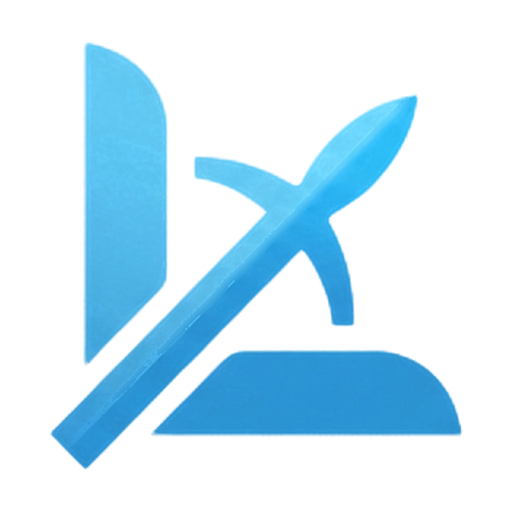

<p align="center">
  
</p>

<h1 align="center">Leme</h1>

<p align="center">
  A lightweight, open source desktop IDE for Kubernetes.<br />
  Native, fast, and a fraction of the memory.
</p>

<p align="center">
  <a href="../../releases/latest">Download</a> ·
  <a href="#features">Features</a> ·
  <a href="#build-from-source">Build</a> ·
  <a href="SECURITY.md">Security</a> ·
  <a href="CONTRIBUTING.md">Contributing</a> ·
  <a href="#support">Buy me a coffee</a>
</p>

---

Leme lets you browse and operate Kubernetes clusters from a desktop app that
uses the operating system's own WebView instead of bundling a browser engine.
A typical session with a cluster open uses **~170 MB of RAM** (measured on macOS).

The UI is in Brazilian Portuguese.

## Features

- **Multiple clusters**: reads your kubeconfig (SSO, exec plugins, client
  certificates), add clusters by pasting a config, switch without restarting.
- **Any resource, live**: workloads, config, network, storage, RBAC and Custom
  Resources, streamed in real time. Regex search, multi-namespace filter,
  configurable columns, bulk delete.
- **Logs and shell**: per-container live logs (including the previous, crashed
  run), an exec shell into containers, and a local terminal scoped to the
  selected cluster.
- **Why did it restart?**: correlates container status and events to explain
  OOMKilled, failing probes, CrashLoopBackOff, image pull errors and more.
- **Metrics**: CPU and memory per pod, node and container, with requests and
  limits drawn on the chart (metrics-server).
- **Safe YAML editing**: find/replace, multi-cursor, server-side dry-run diff,
  optimistic locking so you never overwrite someone else's change.
- **Helm**: releases, revision history, values and rollback, no helm binary
  required.
- **Quick actions**: scale, rollout restart, cordon/drain, ConfigMap and Secret
  editing in place.

## Download

Grab the latest build from [Releases](../../releases/latest):

| OS | File |
|---|---|
| macOS 12+ (Apple Silicon and Intel) | `Leme-<version>-macos-universal.dmg` |
| Windows 10/11 (64-bit) | `Leme-<version>-windows-amd64-setup.exe` |
| Linux x86_64 / ARM64 | `leme_<version>_<arch>.deb` or the standalone `leme-<version>-linux-<arch>` |

Every release ships a `SHA256SUMS.txt`.

**macOS, first launch**: builds are not notarized by Apple yet, so macOS blocks
the first launch ("Apple could not verify Leme is free of malware"). Once:

1. Open the `.dmg` and drag **Leme** to **Applications**.
2. In Terminal run:
   ```bash
   xattr -dr com.apple.quarantine /Applications/Leme.app
   ```
3. Open Leme from Launchpad or Spotlight.

Without Terminal: try to open it, then *System Settings > Privacy & Security >
Open Anyway*.

**Linux**: the standalone binary installs itself into your app menu the first
time you run it (no root). Remove it with `~/.local/bin/leme --uninstall`.
Requires WebKitGTK 4.1 (`libwebkit2gtk-4.1-0`).

## Repository layout

```
apps/desktop/          The desktop app: Go backend (client-go) + Vue 3 UI, packaged with Wails
  internal/            Go packages: cluster sessions, resources, streaming, terminal, helm, metrics
  frontend/            Vue 3 + TypeScript + Tailwind UI
  build/               App icon, platform packaging (Linux .deb, Dockerfile)
  scripts/             Local build helpers (macOS install, Linux via Docker, security audit)
docs/                  Project website, published to GitHub Pages
.github/workflows/     CI, release builds (macOS, Windows, Linux) and Pages deploy
```

## Build from source

Requirements: Go 1.26+, Node.js 20+, and the
[Wails prerequisites](https://wails.io/docs/gettingstarted/installation) for
your OS (Xcode command line tools, WebView2, or GTK3 + WebKitGTK 4.1).

```bash
go install github.com/wailsapp/wails/v2/cmd/wails@v2.16.0

cd apps/desktop
wails dev                                   # hot-reload development
wails build                                 # app in build/bin
wails build -tags webkit2_41                # Linux (WebKitGTK 4.1)
go test ./... && (cd frontend && npm run typecheck)
```

## Releasing

Push a tag and GitHub Actions builds every platform and publishes the release:

```bash
git tag v0.1.0
git push origin v0.1.0
```

To test the pipeline without publishing, run the **Release** workflow manually
(Actions tab): it creates a draft release.

The project page in `docs/` is deployed by the **Pages** workflow. Enable it
once in *Settings > Pages > Source: GitHub Actions*.

## Support

Leme is free and maintained in spare time. If it saves you time, buy the
maintainer a coffee:

- From Brazil (Pix or card, in BRL): [Mercado Pago](https://link.mercadopago.com.br/dindinplanejado)
- From anywhere else: [PayPal](https://www.paypal.com/donate/?hosted_button_id=XRVF9PMEBWVUA)

## License

[Apache License 2.0](LICENSE).

Kubernetes and Helm are registered trademarks of The Linux Foundation. Leme
is an independent project and is not affiliated with or endorsed by The Linux
Foundation or the CNCF. Third-party licenses: [THIRD_PARTY_NOTICES.txt](apps/desktop/THIRD_PARTY_NOTICES.txt).
